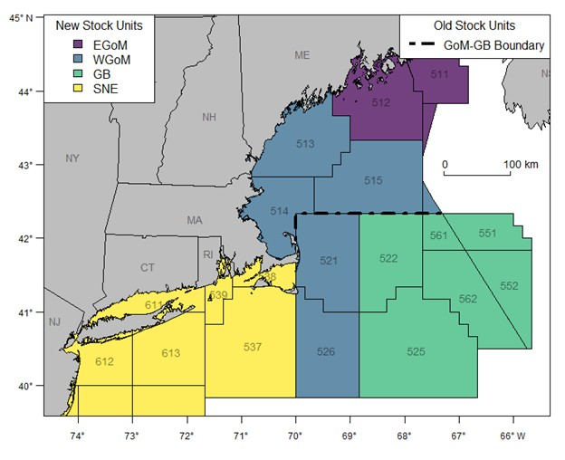

# WGOM Atlantic Cod and GOM Haddock Directed Trips 

**Description**: 

This data contains the simulated directed trips by month, mode, and kind of day for
Western Gulf of Maine (WGOM) Atlantic Cod and Gulf of Maine (GOM) Haddock.
We provide the medians of 101 random draws for the baseline year. 

**Years available**: 

The data are for the baseline regulatory year, also called the calibration year, 
and they are based on the most recent 6 waves of data. For the 2026 management 
cycle, directed trips were simulated using data for waves 1-5 of 2025 and wave 
6 of 2024. 

## Methods

### Data sources

We get data on fishing effort from the Marine Recreational Information Program ([MRIP](https://www.fisheries.noaa.gov/insight/marine-recreational-information-program)). 

### Data extraction 

The data is limited to trips where the angler caught or primarily targeted cod or haddock 
in the WGOM, which includes any Maine or Massachusetts trips taken in statistical areas 
513, 514, 515, 521, and 526, as well as any trips taken from New Hampshire. 
GOM Haddock are assessed in statistical areas 513, 514, 515, 511, and 512, but no Haddock 
are caught in areas 511 and 512 while very few Haddock are caught in areas 521 and 526. 

### Data analysis/Processing

[Data processing code](https://github.com/kimberly-bastille/groundfishRDM/blob/main/Code/pre_sim) 
is in the groundfishRDM repository. 

We turn MRIP survey estimates of directed groundfish trips into per-day, per-draw trip 
counts that the RecDST simulation runs on. First, we estimate directed trips and 
their standard error at the year x month x kind-of-day (weekends including federal 
holidays vs. weekdays) x mode (private/for hire) level over the calibration period.
Next, we use those estimates to create 101 random draws of directed trips for each
stratum. Each draw is divided by the number of days in that stratum to get daily trips.

For the dashboard, we process these daily directed trip draws as follows. First,  
we sum the daily trip data to the month level so we have 101 draws of directed 
trips at the month x mode x kind-of-day level. Then, we take the median of the 101 
draws of directed trips at the month x mode x kind-of-day level to display in the
recDST data dashboard.

